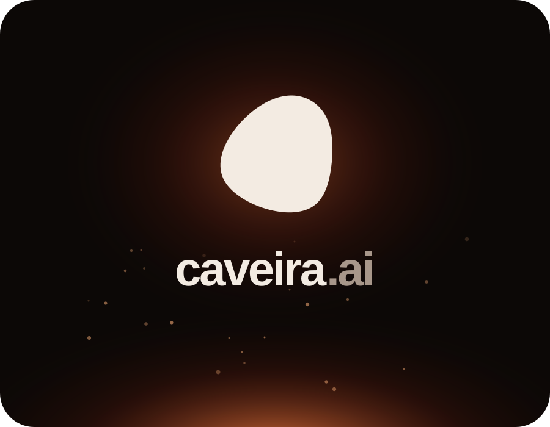

<div align="center">



# caveira.ai

**The website for caveira, and the account its clients sign in to.**<br>
*Plans, payments, and the model proxy that keeps the key off your machine.*

</div>

---

[caveira](https://github.com/justin06lee/caveira) is a coding agent for abliterated models, in the terminal and on the desktop. This is its site: the landing page and pricing, accounts, Stripe subscriptions, the page that connects a client to an account, and an OpenAI-compatible endpoint the clients send their model requests to once they are signed in. The endpoint holds caveira's abliteration.ai key, checks the account's plan and its usage this month, forwards the request, streams the reply back untouched and records what it cost. The clients never hold a key of their own.

It is a Next.js app (App Router) with Tailwind, Drizzle over libSQL (a local SQLite file in development, Turso in production) and Stripe Billing, meant for Vercel.

The landing page opens on the skull between two hands and closes on the burning forest. In between, three paintings serve as desktop wallpapers, each with a live replica of the caveira app on it that you can type into and drag around: a turn that reads, edits and runs code; the import of Claude Code, Codex and OpenCode chats; and the model, effort and permission menus, with an approval card when it asks. The replicas are in `src/components/demo/`, drawn from the desktop app's own palette and layout. Their turns are scripted, and nothing in them talks to a model.

## Develop

```sh
cp .env.example .env.local   # optional: everything in it has a working default
make                         # bun install, migrate local.db, production build
bun run dev
```

With no Stripe key, picking a plan on the pricing page puts the account on it straight away, so the whole thing can be tried without cards. That only happens in development. Put an `ABLITERATION_API_KEY` in `.env.local` to have the proxy answer.

To sign a client in to a local site, point it there:

```sh
CAVEIRA_CLOUD_URL=http://localhost:3000 caveira    # then /login
```

## How signing in works

The terminal and the app use a device login. The client asks `POST /api/auth/device/start` for a code and opens `/device?code=ABCD-EFGH` in the browser. There the person signs in, or already is, checks the code matches the one the client shows, and presses Connect. Meanwhile the client polls `POST /api/auth/device/poll`, and once the code is connected it gets a token, once. It keeps the token in `~/.caveira/auth.json` and sends it as a bearer from then on. Tokens and device codes are stored only as SHA-256 hashes. The account page lists connected machines and can disconnect any of them.

## API

| Route | What it does |
|---|---|
| `POST /api/auth/signup`, `/login`, `/logout` | Email and password accounts with a session cookie. `logout` also ends a client's bearer token. |
| `POST /api/auth/device/start`, `/poll`, `/approve` | The device login above. |
| `GET /api/me` | Email, plan, and the share of this month's usage spent. |
| `GET /api/v1/models`, `POST /api/v1/chat/completions` | The OpenAI-compatible proxy. It answers 401 to a bad token, 403 for a model the plan doesn't include and 402 once the month's usage is spent, each with a message that says what to do. |
| `POST /api/billing/checkout` | Stripe Checkout for a first plan, or Stripe's confirm page to switch or cancel a running one. |
| `POST /api/billing/portal` | Stripe's billing portal: cards, invoices, cancelling. |
| `POST /api/stripe/webhook` | Subscription events, verified by signature. |
| `DELETE /api/sessions/:id` | Disconnects one of the account's machines. |

## Plans and usage

The plans are in `src/lib/plans.ts`, the same ones the desktop app lists. Usage is counted in dollars of what the models cost on abliteration.ai, per calendar month in UTC. Free gets `USAGE_UNIT_USD` of it (5 unless set), and the paid plans get 2x, 5x, 10x and 20x that. A reply cut off before its usage report is counted from the characters sent and streamed.

Stripe prices are found by lookup key (`caveira_<plan>_monthly`), so no price ids live in the environment. Every webhook event about a customer re-reads their subscription from Stripe and writes what it says, and so does the return from Checkout. Whichever gets there first is right, and order and repeats don't matter. A `past_due` subscription keeps its plan while Stripe retries the card.

## Deploy

1. Create the Turso database and run the migrations against it: `TURSO_DATABASE_URL=… TURSO_AUTH_TOKEN=… bun run db:migrate`.
2. Set the variables from `.env.example` on Vercel, with `APP_URL` as the site's address.
3. In Stripe, add a webhook endpoint at `<APP_URL>/api/stripe/webhook` for `checkout.session.*`, `customer.subscription.*`, `invoice.paid` and `invoice.payment_failed`, and put its signing secret in `STRIPE_WEBHOOK_SECRET`.
4. Live mode needs the same four products and prices and the portal configuration as the sandbox. They're described in `src/lib/plans.ts`, and the portal configuration carries the metadata `app=caveira`, which is how the site finds it.

A reply can stream for minutes. The chat route asks for 300 seconds, the most Vercel's Hobby plan allows, and can go up to 800 on Pro.
